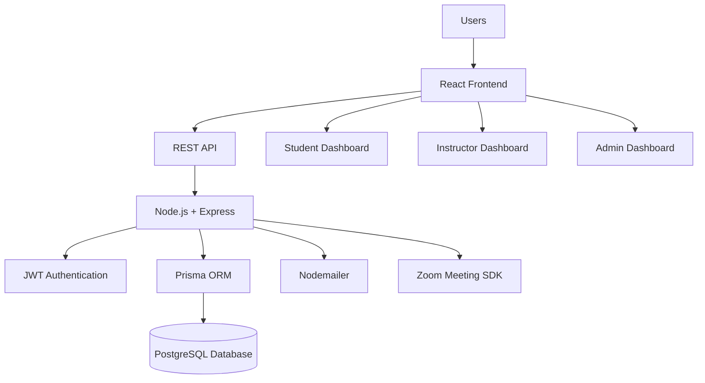
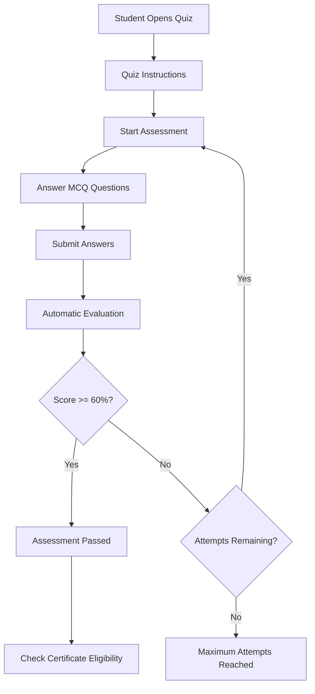
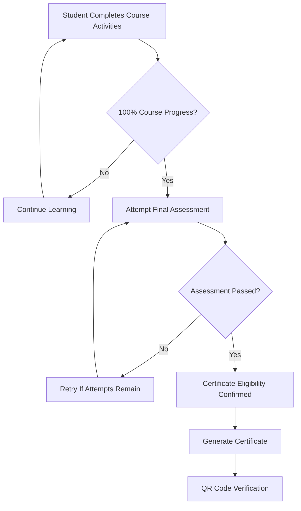

# 🎓 Swift Institute LMS
### A Modern Full-Stack Learning Management System

<p align="center">
  A comprehensive Learning Management System designed to streamline online education through dedicated student, instructor, and administrator portals.
</p>

<p align="center">
  
  
  
  
  
  
  
  
</p>

<p align="center">
  <strong>React • Vite • Tailwind CSS • Node.js • Express • PostgreSQL • Prisma • JWT • Zoom Meeting SDK</strong>
</p>

---

## 📌 Table of Contents

- [Overview](#-overview)
- [Project Objectives](#-project-objectives)
- [Key Highlights](#-key-highlights)
- [User Roles and Portals](#-user-roles-and-portals)
- [Features and Functionality](#-features-and-functionality)
- [Technology Stack](#-technology-stack)
- [System Architecture](#-system-architecture)
- [Database and Data Management](#-database-and-data-management)
- [Authentication and Security](#-authentication-and-security)
- [Zoom Meeting Integration](#-zoom-meeting-integration)
- [Quiz and Assessment System](#-quiz-and-assessment-system)
- [Certificate Generation](#-certificate-generation)
- [Project Structure](#-project-structure)
- [Installation and Setup](#-installation-and-setup)
- [Environment Variables](#-environment-variables)
- [API Documentation](#-api-documentation)
- [Deployment](#-deployment)
- [Screenshots](#-screenshots)
- [Future Improvements](#-future-improvements)
- [Contributing](#-contributing)
- [Author](#-author)

---

## 📖 Overview

**Swift Institute LMS** is a full-stack Learning Management System (LMS) developed to provide a centralized digital learning environment for students, instructors, and administrators.

The platform simplifies educational management by bringing course administration, learning materials, assignments, quizzes, live online classes, student progress tracking, and certificate generation into one integrated system.

The application follows a role-based architecture, providing each user type with dedicated dashboards and functionality according to their responsibilities.

The system combines a modern React frontend with a Node.js and Express backend, PostgreSQL database management through Prisma ORM, JWT-based authentication, and Zoom Meeting SDK integration for online classes.

The interface is designed with a modern, responsive layout, intuitive navigation, and a clean user experience across different devices.

**Live Preview:** https://lms-swift.vercel.app/

---

## 🎯 Project Objectives

- Digitize traditional educational and administrative workflows.
- Provide a centralized platform for managing courses and learning materials.
- Enable instructors to organize classes, assignments, and assessments.
- Allow students to access educational resources and monitor their progress.
- Facilitate real-time online learning through integrated Zoom meetings.
- Automate quiz evaluation and certificate eligibility.
- Provide administrators with centralized control over users and educational activities.
- Improve communication and accessibility between different platform users.

---

## ✨ Key Highlights

| Feature | Description |
|---|---|
| Multi-Role Architecture | Separate Student, Instructor, and Admin portals |
| Secure Authentication | JWT-based authentication and authorization |
| Email Verification | OTP-based email verification |
| Course Management | Course creation, organization, and content management |
| Assignments | Assignment distribution and student submissions |
| Online Classes | Zoom Meeting SDK integration |
| Quiz System | MCQ assessments with automated evaluation |
| Progress Tracking | Monitor student learning progress |
| Certificates | Certificate eligibility and generation |
| QR Verification | QR-based certificate verification |
| Responsive UI | Adaptable interface for different screen sizes |
| Database Management | PostgreSQL with Prisma ORM |

---

## 👥 User Roles and Portals

The system is built around three primary user roles, each with its own dashboard and permissions.

### 1. 🎓 Student Portal

The Student Portal provides learners with access to their enrolled courses and learning activities.

**Features:**

- Student registration and login.
- Email OTP verification.
- Personalized student dashboard.
- View enrolled courses.
- Access course content and learning materials.
- View assignments and submit required work.
- Attempt course quizzes and MCQ assessments.
- View quiz results and assessment status.
- Join scheduled online classes.
- Track course completion and learning progress.
- View certificate eligibility.
- Access generated certificates.
- Profile and account management.

### 2. 👨‍🏫 Instructor Portal

The Instructor Portal enables instructors to manage educational content and monitor student activities.

**Features:**

- Secure instructor authentication.
- Dedicated instructor dashboard.
- Course management.
- Upload and organize course content.
- Manage assignments.
- Review student submissions.
- Create and manage quizzes.
- Manage MCQ questions and assessment settings.
- Schedule and manage online classes.
- Conduct live classes through Zoom integration.
- Monitor student participation and progress.
- Manage course-related educational activities.

### 3. 🛡️ Admin Portal

The Admin Portal provides centralized management and administrative control over the LMS.

**Features:**

- Secure administrator login.
- Administrative dashboard.
- User management.
- Student management.
- Instructor management.
- Course management and oversight.
- Monitor educational activities.
- Manage platform information.
- Oversee platform operations.

---

## 🚀 Features and Functionality

### 📚 1. Course Management

The course management module provides the foundation for organizing educational content.

- Create and manage courses.
- Organize learning materials.
- Maintain course-related information.
- Provide students with access to their enrolled courses.
- Allow instructors to manage their educational content.

### 📝 2. Assignment Management

The assignment module facilitates communication of academic tasks between instructors and students.

- Instructors can create and manage assignments.
- Students can view assigned tasks.
- Students can submit their work.
- Instructors can review submissions.

### 📊 3. Quiz and Assessment Management

The platform includes an MCQ-based assessment system for evaluating student knowledge.

**Assessment functionality:**

- MCQ-based quizzes.
- Question and answer management.
- Automated answer evaluation.
- Automatic score calculation.
- Attempt tracking.
- Pass/fail evaluation.
- Configurable assessment settings.

**Final Assessment Rules:**

| Rule | Configuration |
|---|---|
| Maximum Attempts | 3 |
| Passing Percentage | 60% |
| Time Limit | 1 minute per question |
| Evaluation | Automatic MCQ evaluation |

Students must achieve the required passing percentage within the allowed attempts to qualify for successful course completion.

### 🎥 4. Live Online Classes

The platform integrates Zoom Meeting SDK to facilitate online learning.

**Features:**

- Schedule online classes.
- Manage scheduled class information.
- Allow students to join available sessions.
- Enable instructors to conduct live classes.
- Integrate video conferencing into the learning workflow.
- Support microphone and camera functionality.
- Manage class participation and attendance-related information.

### 📈 5. Student Progress Tracking

The LMS provides progress-related functionality to help students and instructors monitor learning activities.

- Monitor course completion.
- Track learning progress.
- View assessment performance.
- Identify course completion status.
- Determine certificate eligibility.

### 🏆 6. Certificate Generation

The certificate module recognizes students who successfully complete the required course activities.

**Certificate Eligibility Requirements:**

1. Complete 100% of the required course content.
2. Successfully pass the final MCQ assessment.
3. Meet the platform's certificate eligibility conditions.

**Certificate Features:**

- Automated eligibility checking.
- Certificate generation for eligible students.
- Course and student information.
- QR code integration for certificate verification.
- Certificate identification and verification.

### 🔐 7. Email OTP Verification

The system uses email-based OTP verification as part of the authentication workflow.

- Email verification.
- OTP delivery through Nodemailer.
- Verification before completing the applicable registration process.
- Email-based communication.

### 📱 8. Responsive User Interface

The frontend is designed to provide an accessible experience across multiple devices.

- Modern dashboard layouts.
- Responsive navigation.
- Reusable UI components.
- Structured content presentation.
- Mobile-friendly layouts.
- Consistent styling using Tailwind CSS.
- Smooth and intuitive user interactions.

---

## 🛠️ Technology Stack

The project uses modern frontend and backend technologies to provide a maintainable and scalable application architecture.

### Frontend

| Technology | Purpose |
|---|---|
| React.js | Component-based user interface |
| Vite | Frontend development and build tooling |
| Tailwind CSS | Responsive styling and UI design |
| JavaScript | Application functionality |

### Backend

| Technology | Purpose |
|---|---|
| Node.js | Server-side JavaScript runtime |
| Express.js | Backend framework and API development |
| Prisma ORM | Database access and management |
| JWT | Authentication and authorization |
| Nodemailer | Email communication and OTP delivery |

### Database

| Technology | Purpose |
|---|---|
| PostgreSQL | Relational database |
| Prisma | Database ORM and schema management |
| Neon PostgreSQL | Managed cloud database hosting |

### Integrations and Tools

| Technology | Purpose |
|---|---|
| Zoom Meeting SDK | Live online classes |
| Git | Version control |
| GitHub | Source code management |
| Postman | API testing |
| Netlify | Frontend deployment |
| Railway | Backend deployment |

---

## 🏗️ System Architecture

The application follows a client-server architecture with separate frontend, backend, and database layers.



### Architecture Components

**Frontend Layer**
- React-based user interface.
- Role-specific dashboards.
- Responsive components.
- API communication.

**Backend Layer**
- Express.js API endpoints.
- Authentication and authorization.
- Business logic.
- Request validation.
- Database operations.

**Database Layer**
- PostgreSQL relational database.
- Prisma ORM.
- Structured data management.

**External Integrations**
- Zoom Meeting SDK for live classes.
- Nodemailer for email communication.

---

## 🗄️ Database and Data Management

The application uses PostgreSQL as its relational database and Prisma ORM for database interaction.

Prisma provides a structured way to define database models, manage relationships, and perform database operations.

**Database responsibilities include:**

- User and account information.
- Role-related information.
- Course information.
- Educational content.
- Assignment records.
- Quiz and assessment data.
- Student progress information.
- Class-related information.
- Certificate-related records.

The database schema and relationships are managed through Prisma.

---

## 🔒 Authentication and Security

Security is an important part of the application architecture.

The system implements authentication and role-based authorization to control access to different platform features.

**Security-related functionality:**

- JWT-based authentication.
- Protected application routes.
- Role-based access control.
- Separate permissions for students, instructors, and administrators.
- Email OTP verification.
- Secure API communication.
- Server-side authorization checks.
- HTTP-only cookie-based authentication where configured.

---

## 🎥 Zoom Meeting Integration

The LMS integrates Zoom Meeting SDK to support live online classes.

The integration allows instructors to conduct online sessions while students can join their scheduled classes through the platform.

**Integration highlights:**

- Zoom meeting initialization.
- Scheduled class joining.
- Instructor and student meeting experiences.
- Camera and microphone access.
- Live online learning.
- Meeting participation functionality.

---

## 🧠 Quiz and Assessment Workflow

The assessment system follows a structured evaluation process.



The final assessment includes a maximum of three attempts, a passing score of 60%, and a time allowance of one minute per question.

---

## 🏅 Certificate Generation Workflow

Certificates are generated when students satisfy the defined course completion and assessment requirements.



---

## 📂 Project Structure

The project uses separate frontend and backend directories.

The following is a representative structure; actual filenames and directories may vary according to the implementation.

```text
swift-institute-lms/
│
├── frontend/
│   ├── public/
│   ├── src/
│   │   ├── assets/
│   │   ├── components/
│   │   ├── pages/
│   │   ├── layouts/
│   │   ├── hooks/
│   │   ├── services/
│   │   ├── context/
│   │   ├── utils/
│   │   ├── App.jsx
│   │   └── main.jsx
│   │
│   ├── index.html
│   ├── package.json
│   └── vite.config.js
│
├── backend/
│   ├── prisma/
│   │   └── schema.prisma
│   │
│   ├── controllers/
│   ├── routes/
│   ├── middleware/
│   ├── services/
│   ├── utils/
│   ├── config/
│   ├── index.js
│   └── package.json
│
├── .gitignore
└── README.md
```

---

## ⚙️ Installation and Setup

Follow these instructions to run the application locally.

### Prerequisites

Make sure the following tools are installed:

- Node.js (LTS recommended)
- npm
- Git
- PostgreSQL database or Neon PostgreSQL account

### 1. Clone the Repository

```bash
git clone YOUR_GITHUB_REPOSITORY_URL
```

Navigate to the project directory:

```bash
cd swift-institute-lms
```

### 2. Install Frontend Dependencies

```bash
cd frontend
npm install
```

### 3. Install Backend Dependencies

Open another terminal:

```bash
cd backend
npm install
```

### 4. Configure Environment Variables

Create a `.env` file in the backend directory and configure the required environment variables.

See the [Environment Variables](#-environment-variables) section.

### 5. Configure the Database

After configuring your PostgreSQL connection string, run:

```bash
npx prisma generate
```

Synchronize the database schema:

```bash
npx prisma db push
```

### 6. Start the Backend Server

```bash
node index.js
```

### 7. Start the Frontend Development Server

Navigate to the frontend directory:

```bash
npm run dev
```

The frontend will be available at the local URL displayed by Vite, usually:

```text
http://localhost:5173
```

The backend will run on the port configured in its environment variables.

---

## 🔑 Environment Variables

The backend requires environment variables for database connectivity, authentication, email services, and integrations.

Create a `.env` file inside the backend directory.

Example configuration:

```env
# Server Configuration
PORT=5000
NODE_ENV=development

# Database
DATABASE_URL="YOUR_POSTGRESQL_CONNECTION_STRING"

# Authentication
JWT_SECRET="YOUR_SECURE_JWT_SECRET"

# Frontend URL
FRONTEND_URL="http://localhost:5173"

# Email Configuration
SMTP_HOST="YOUR_SMTP_HOST"
SMTP_PORT=587
SMTP_USER="YOUR_EMAIL_ADDRESS"
SMTP_PASS="YOUR_EMAIL_PASSWORD"

# Zoom Configuration
ZOOM_SDK_KEY="YOUR_ZOOM_SDK_KEY"
ZOOM_SDK_SECRET="YOUR_ZOOM_SDK_SECRET"
```

**Important:**

- Replace all placeholder values with your actual credentials.
- Match environment variable names with those referenced in your application code.
- Never upload `.env` files containing real credentials.
- Keep database passwords, JWT secrets, SMTP credentials, and Zoom secrets private.
- Add `.env` to `.gitignore`.

---

## 🔌 API Documentation

The backend exposes RESTful APIs to handle communication between the frontend and server.

The API layer is responsible for authentication, user management, course operations, assignments, assessments, and other application functionality.

### Main API Modules

| Module | Responsibility |
|---|---|
| Authentication | Registration, login, logout and verification |
| Users | User account management |
| Students | Student-related operations |
| Instructors | Instructor-related operations |
| Admin | Administrative operations |
| Courses | Course management |
| Content | Learning material management |
| Assignments | Assignment management and submissions |
| Quizzes | Quiz and assessment operations |
| Classes | Online class management |
| Progress | Student progress tracking |
| Certificates | Certificate generation and verification |

**Note:** Actual API endpoint URLs, HTTP methods, request parameters, and response structures depend on the implemented backend routes.

---

## ☁️ Deployment

The application uses cloud-based deployment services for hosting its frontend, backend, and database.

| Component | Deployment Platform |
|---|---|
| Frontend | Netlify / Vercel |
| Backend | Railway |
| Database | Neon PostgreSQL |

The deployment environment requires appropriate environment variables, database connectivity, and frontend-backend URL configuration.

**Live Application:** https://lms-swift.vercel.app/

---

## 📸 Screenshots

Add screenshots of your actual application in the following directory:

```text
screenshots/
```

Use the following suggested organization:

```text
screenshots/
│
├── home-page.png
├── login-page.png
├── registration-page.png
│
├── student-dashboard.png
├── student-courses.png
├── student-assignments.png
├── student-quiz.png
├── student-progress.png
├── student-certificate.png
│
├── instructor-dashboard.png
├── instructor-courses.png
├── instructor-assignments.png
├── instructor-quiz-management.png
├── instructor-live-classes.png
│
├── admin-dashboard.png
├── admin-users.png
└── live-class.png
```

### Application Preview

**Homepage**


**Student Dashboard**


**Instructor Dashboard**


**Admin Dashboard**


**Course Management**


**Quiz and Assessment**


**Certificate**


> Replace the screenshot placeholders with actual screenshots from your application. GitHub will automatically display images when the referenced files exist in the repository.

---

## 🔮 Future Improvements

Potential enhancements for future versions include:

- Advanced analytics and reporting dashboards.
- Enhanced student-instructor communication.
- Automated attendance reporting.
- Additional assessment formats.
- Advanced course recommendation functionality.
- Enhanced certificate verification.
- More comprehensive notification functionality.
- Improved accessibility and user experience.
- Additional administrative reporting tools.

---

## 🤝 Contributing

Contributions, suggestions, and feedback are welcome.

If you would like to contribute:

1. Fork the repository.
2. Create a new feature branch.

```bash
git checkout -b feature/your-feature-name
```

3. Commit your changes.

```bash
git commit -m "Add: your feature description"
```

4. Push your branch.

```bash
git push origin feature/your-feature-name
```

5. Open a Pull Request.

---

## 👨‍💻 Author

**Muhammad Abdullah**

Full-Stack Developer | MERN Stack | React.js | Node.js | Python | AI Integration

Interested in developing scalable web applications, modern user interfaces, backend systems, and AI-powered solutions.

- **GitHub:** [Add Your GitHub Profile](https://github.com/YOUR_GITHUB_USERNAME)
- **LinkedIn:** [Add Your LinkedIn Profile](https://linkedin.com/in/YOUR_LINKEDIN_USERNAME)
- **Portfolio:** [Add Your Portfolio URL](https://example.com)
- **Email:** YOUR_EMAIL_ADDRESS

---

## 📄 License

This project is developed as an educational and software development project.

All rights reserved unless otherwise specified by the repository owner.

---

<p align="center">
  <strong>Swift Institute LMS</strong>
  <br />
  Empowering Digital Learning Through Technology.
  <br /><br />
  ⭐ If you find this project interesting, consider giving it a star!
</p>
